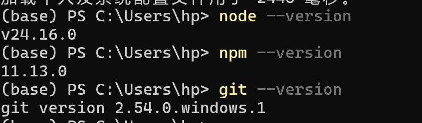
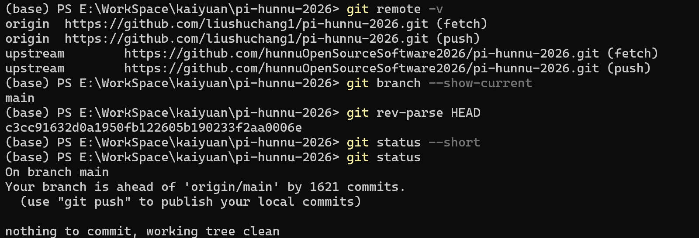
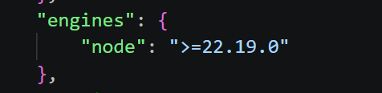
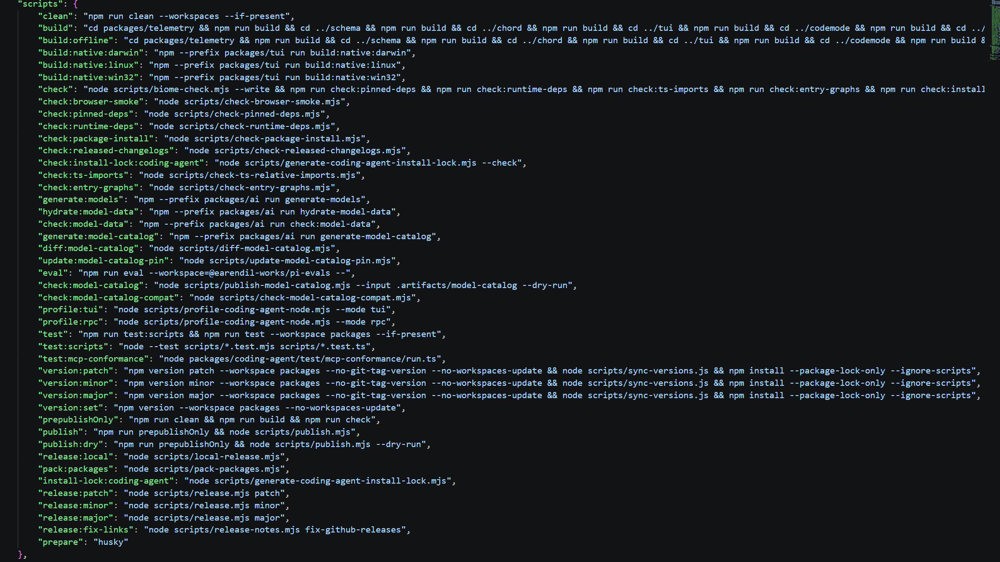
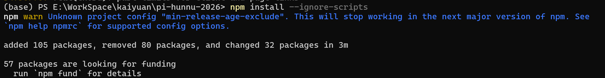
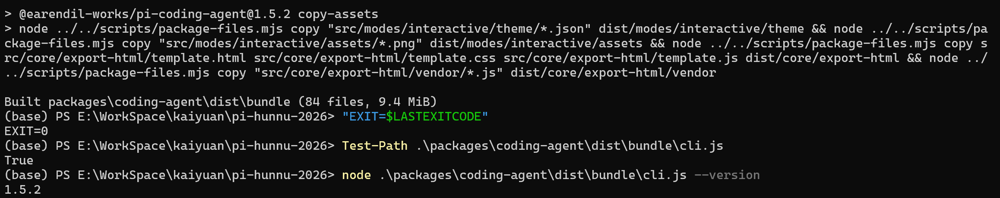
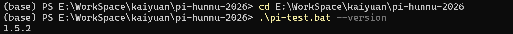
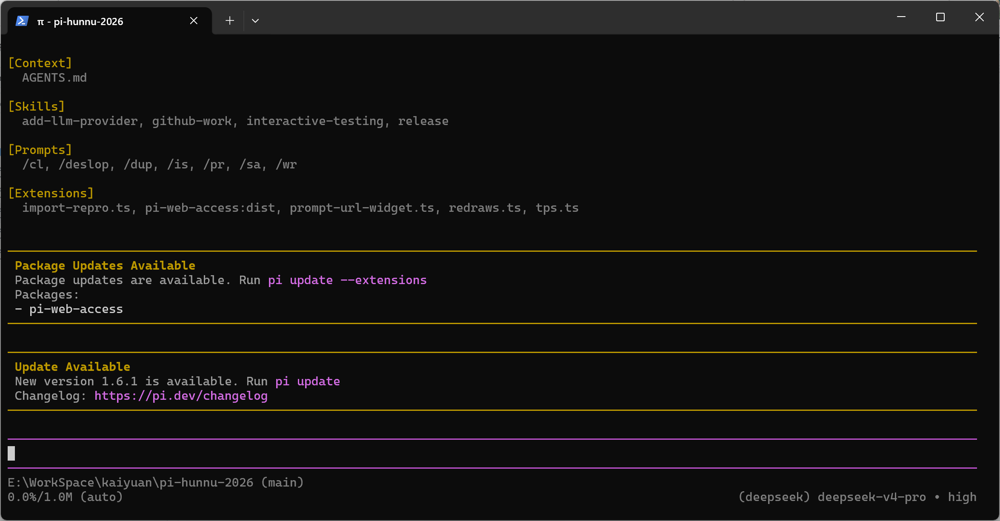
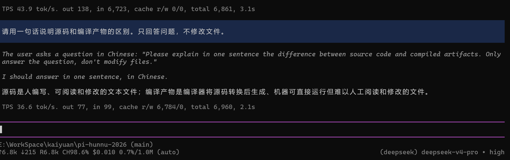

# 实践课3：Pi Agent 源码获取、依赖安装与本地编译

## 0. 基本信息

| 项目 | 内容 |
|---|---|
| 姓名 / 学号 | 【填写姓名与学号】 |
| 小组组织仓库 | https://github.com/liushuchang1/pi-hunnu-2026 |
| 个人报告仓库 | https://github.com/Aglioble/pi-homework（本报告位于 `practice3/` 目录） |
| 本地源码目录 | `E:\WorkSpace\kaiyuan\pi-hunnu-2026` |
| 当前分支 | `main` |
| 当前提交 | `c3cc91632d0a1950fb122605b190233f2aa0006e` |
| 源码版本 | 1.5.2（`packages/coding-agent/package.json`） |
| 使用的构建命令 | `npm run build:offline`（原因见第 7 节困难 1） |

本次实验在三项工具版本上使用的实际结果：Node.js `v24.16.0`、npm `11.13.0`、Git `2.54.0.windows.1`。源码、依赖、构建产物分别对应三个位置：源码在仓库 `packages/*/src`，依赖落在根目录 `node_modules`，构建产物在 `packages/*/dist`，其中 CLI 打包产物为 `packages/coding-agent/dist/bundle/cli.js`。当前运行的是本地源码编译出来的 1.5.2 版本。

---

## 1. 任务一 实验准备：检查开发工具

在 PowerShell 中逐条执行三条检查命令：

```powershell
node --version
npm --version
git --version
```



结果与判断：

| 工具 | 实际版本 | 是否满足要求 |
|---|---|---|
| Node.js | v24.16.0 | 满足根项目 `engines.node >= 22.19.0`，且属于 24 LTS，避开旧依赖 `EBADENGINE` 警告 |
| npm | 11.13.0 | 随 Node.js 官方安装包提供，未单独安装 |
| Git | 2.54.0.windows.1 | 已在 PATH 中，可直接执行 `git` 命令 |

Node.js 的版本要求来自仓库根 `package.json` 的 `engines` 字段，不是根据截图里的版本反推的。三条命令在同一个窗口里连续执行，说明当前终端能同时找到这三项工具，这也是后续所有命令的执行环境。

---

## 2. 任务二 确认源码来源和版本

本次使用的源码是实践课2 已经克隆到本地的小组仓库，不需要重新下载。进入目录后记录来源和版本：

```powershell
cd E:\WorkSpace\kaiyuan\pi-hunnu-2026
Get-Location
git remote -v
git branch --show-current
git rev-parse HEAD
git status --short
git status
```



观察结果：

- 当前目录 `E:\WorkSpace\kaiyuan\pi-hunnu-2026`，为全英文路径。
- `origin` 的 fetch / push 地址均指向小组组织仓库 `https://github.com/liushuchang1/pi-hunnu-2026.git`。
- 当前分支 `main`。
- 完整提交编号 `c3cc91632d0a1950fb122605b190233f2aa0006e`。
- `git status --short` 无输出，`git status` 显示 `nothing to commit, working tree clean`，工作区干净。

截图里还多出一个 `upstream` 远端，指向老师仓库 `https://github.com/hunnuOpenSourceSoftware2026/pi-hunnu-2026.git`。它是在解决构建问题时新增的同步来源，见第 7 节困难 1。`git status` 中的 `ahead of 'origin/main' by 1621 commits` 表示本地已经同步到老师仓库最新提交，而小组远端仍停在实践课2 使用的旧提交 `71dca87`；本地没有向小组远端推送。

---

## 3. 任务三 阅读配置，确认安装与编译的依据

按老师要求查看了以下文件：

| 文件 | 观察到的内容 |
|---|---|
| `README.md` | `Development` 一节给出 `npm install --ignore-scripts` 与 `npm run build` 两条命令，本次安装和构建的命令即出自这里 |
| `package.json` | `engines`、`workspaces`、`scripts`、`devDependencies` 四项齐全 |
| `package-lock.json` | 锁定依赖版本与依赖关系，安装时与实际声明比对 |
| `packages/` | `agent`、`ai`、`chord`、`codemode`、`coding-agent`、`durable`、`env`、`evals`、`mcp`、`schema`、`telemetry`、`tui` 十二个子包 |
| `packages/coding-agent/package.json` | `bin` 为 `"pi": "dist/bundle/cli.js"`，即 CLI 入口；`build` 分两步：先 `build:unbundled` 编译，再执行 `scripts/build-coding-agent-bundle.mjs` 打包 |

根 `package.json` 中的 `engines`：



根 `package.json` 中的 `scripts`（第一行即 `build`，第二行为 `build:offline`）：



**问一：Node.js 版本要求在哪里？**

写在仓库根目录 `package.json` 的 `engines.node` 字段，值为 `>=22.19.0`，位置在第 69～71 行。这是根项目对运行环境的显式声明，属于配置而不是推测；同一次同步过来的各子包 `package.json` 里也各自声明了相同的下限。本机用 Node.js 24 LTS，高于该下限，因此安装与构建过程中没有出现 `EBADENGINE`。

**问二：`npm run build` 实际从哪里读取命令？**

在仓库根目录执行 `npm run build` 时，npm 读取根 `package.json` 的 `scripts.build`，把这一整串 shell 命令交给终端执行。根这一行只做流程编排，自己不编译任何代码，它 `cd` 进第一个子包执行该子包的 `npm run build`，成功后才由 `&&` 进入下一个。当前版本的顺序是：

```
telemetry → schema → chord → tui → codemode → mcp → ai → durable → env → agent → coding-agent
```

每个子包再读取自己的 `package.json` 中的 `build`：`telemetry`、`schema`、`chord`、`tui`、`codemode`、`mcp`、`durable`、`env`、`agent` 都是 `tsc -p tsconfig.build.json`，把 `src` 中的 TypeScript 编译到各自的 `dist`；`ai` 是先用 `catalog/generate.ts --strict` 生成模型目录数据，再执行 `build:offline`（校验数据 → 编译 → 复制 `data` 目录）；`coding-agent` 是先 `build:unbundled` 编译并复制静态资源，再跑 bundle 脚本把整个 CLI 打成单文件。所以 npm 并不存在“对所有项目统一执行同一套编译”的行为，具体编译内容完全由这些脚本决定，根命令只是把它们按顺序串起来。

仓库用 npm workspaces 管理多个包，因此依赖必须从根目录安装，构建也必须从根目录按脚本顺序执行，不给子包单独生成新的锁文件。

---

## 4. 任务四 安装项目依赖

确认当前目录包含根 `package.json` 后执行：

```powershell
npm install --ignore-scripts
"EXIT=$LASTEXITCODE"
```



这条命令做的工作，结合本次输出逐条对应：

1. 按 `package.json` 与 `package-lock.json` 解析、下载依赖，锁文件与声明一致时使用锁定版本。
2. 在根目录建立 `node_modules`，并用 workspaces 机制把 `packages/` 下的本地包互相链接起来。
3. 安装项目需要的库与开发工具，例如 TypeScript 编译器、Biome、esbuild、打包脚本依赖。
4. `--ignore-scripts` 跳过安装阶段自动触发的生命周期脚本（如 `postinstall`、`prepare` 里的 husky），避免在依赖装齐前执行钩子；这不会影响后面主动执行 `npm run build`。

本次实测结果：`added 105 packages, removed 80 packages, and changed 32 packages in 3m`，退出码 `0`，`Test-Path .\node_modules` 为 `True`。输出中只有一条警告 `Unknown project config "min-release-age-exclude"`，来自仓库自带 `.npmrc` 中一个 npm 新版本不再识别的配置项，属于提示，不影响安装结果；整个过程没有 `EBADENGINE`，没有 `ERESOLVE`，也没有漏洞审计报告。

两个坑刻意避开：命令没有加 `-g`，所以装的是当前项目依赖，不会把本地 Pi 安装成全局 `pi` 命令；看到漏洞提示也不执行 `npm audit fix --force`，避免改掉课程锁定的依赖版本。

---

## 5. 任务五 本地编译与构建产物验证

首次构建按老师文档应执行 `npm run build`。这一步会进入 `ai` 子包联网拉取模型目录数据，本次因为数据源不可达而中止，改用复用已有模型数据的等价命令：

```powershell
npm run build:offline
"EXIT=$LASTEXITCODE"
```

构建完成后检查产物：

```powershell
Test-Path .\packages\coding-agent\dist\bundle\cli.js
node .\packages\coding-agent\dist\bundle\cli.js --version
```



结果：

- 十一站全部通过，最后进入 `coding-agent`，输出 `Built packages\coding-agent\dist\bundle (84 files, 9.4 MiB)`。
- 构建退出码 `EXIT=0`。
- `Test-Path` 输出 `True`，入口文件存在。
- 用本地路径运行该入口，版本号输出 `1.5.2`，与 `packages/coding-agent/package.json` 中的 `version` 一致，说明产物确实来自本次编译的源码。

`src` 与 `dist` 的区别：`src` 是手写源码，修改程序应改这里；`dist` 是编译输出，下次构建会被覆盖，不应直接改。

`npm run build` 与 `npm run build:offline` 的区别：前者先让 `ai` 重新联网生成模型目录，再编译；后者跳过生成，复用现有 `src/providers/data` 直接编译。首次安装或首次初始化数据不能用后者替代，但数据已就绪后，后者就是日常重编译的正确命令。

---

## 6. 任务六 启动本地源码版并完成一次会话

先验证源码入口，注意必须用 `.bat` 入口而不是全局 `pi`：

```powershell
.\pi-test.bat --version
```



再启动交互界面：

```powershell
.\pi-test.bat
```



界面底部路径与分支为 `E:\WorkSpace\kaiyuan\pi-hunnu-2026 (main)`，右侧模型为 `deepseek-v4-pro`。启动没有要求重新 `/login`，因为本地源码版与实践课1 安装的 Pi 共用 `~/.pi/agent` 配置目录，凭据仍有效。

随后发送提问：

```text
请用一句话说明源码和编译产物的区别。只回答问题，不修改文件。
```



实际收到模型回复：“源码是人编写、可阅读和修改的文本文件；编译产物是编译器将源码转换后生成、机器可直接运行但难以人工阅读和修改的文件。”截图未包含 API Key、`auth.json` 或授权回调地址。

**报告说明：本次如何确保运行的是本地源码？**

三条证据互相印证：一是入口用的是仓库里的 `.\pi-test.bat`，它调用 `pi-test.ps1`，实际执行 `node --import packages/coding-agent/src/experimental/source-resolver.ts packages/coding-agent/src/cli.ts`，直接加载 `src` 下的 TypeScript 源码，不经过 `dist`；二是 `.\pi-test.bat --version` 输出 1.5.2，与本次编译的源码版本一致；三是界面底部显示当前工作目录与分支为该仓库 `main`。如果直接输入全局 `pi`，启动的可能是实践课1 安装的全局版本，无法证明跑的是刚同步的源码。

**源码入口与 `dist/bundle/cli.js` 入口分别适合什么场景？**

源码入口适合开发调试：改完 `src` 立刻生效，不需要先构建，能看到最新改动；代价是要经过 TypeScript 解析、启动稍慢，且依赖 `node_modules` 完整。
`dist/bundle/cli.js` 入口适合验证构建产物和日常使用：它是打包后的单文件产物，启动快、依赖自带，最接近发布形态；代价是改源码后必须重新构建才生效。两者版本号一致，说明源码与产物同步。

---

## 7. 遇到的困难与解决过程（重点）

### 困难 1：小组仓库停留在旧提交，生成模型目录后出现三个编译错误

现象。首次在小组仓库原提交 `71dca87`（版本 0.85.1）上执行构建，前面的包都能过，到 `ai` 子包报出三个类型错误：

```
src/api/google-shared.ts:402:10 - error TS2322: Type 'FinishReason.TOO_MANY_TOOL_CALLS' is not assignable to type 'never'.
src/providers/kimi-coding.ts:5:36 - error TS2307: Cannot find module './kimi-coding.models.ts'
src/providers/opencode-go.ts:14:3 - error TS2322: 类型不兼容，'google-generative-ai' 不在该 provider 声明的三种 api 内
Found 3 errors in 3 files.
```

定位。三个错误分两类。第一类是源码里的 switch 没覆盖 Google SDK 新增的 `FinishReason.TOO_MANY_TOOL_CALLS` 枚举成员，穷尽检查因此失败；第二类是生成脚本按当天线上数据重写模型目录，`models.dev` 上 kimi-coding 已无可用模型导致 `kimi-coding.models.ts` 被删除，而 `opencode-go` 的新数据里混入了 gemini 模型。根因是小组 fork 停在 9 月 11 日的老提交，与线上模型目录的现状已经对不上，不是环境配置错误。

解决。比对后发现老师仓库 `main` 已经推进到 1.5.2，且 `google-shared.ts` 里已经补上了 `case FinishReason.TOO_MANY_TOOL_CALLS:`，说明这类问题上游已修。于是把小组仓库同步到老师最新提交：

```powershell
git remote add upstream https://github.com/hunnuOpenSourceSoftware2026/pi-hunnu-2026.git
git fetch upstream main
git merge-base --is-ancestor HEAD upstream/main   # 返回 0，说明可快进
git restore .
git merge --ff-only upstream/main                 # 快进到 c3cc9163，4563 个文件更新
```

结果。本地提交变为 `c3cc91632d0a1950fb122605b190233f2aa0006e`，版本 1.5.2，三个错误不再出现，另外还带回了 `schema`、`codemode`、`mcp`、`durable`、`env` 这些实践课2 报告里“不存在”的子包，结构与老师文档一致。

### 困难 2：严格模式的构建被 Radius 数据源阻断

现象。同步后执行 `npm run build`，进入 `ai` 的 `generate-models` 后中止：

```
Fetching models.dev catalog...
Fetching NVIDIA NIM models...
Fetching OpenRouter models...
Fetching Vercel AI Gateway models...
Fetching Radius models...
Failed to fetch Radius models: TypeError: fetch failed
  [cause]: ConnectTimeoutError: Connect Timeout Error (attempted addresses: 104.21.62.67:443, timeout: 10000ms)
```

定位。`generate-models` 即 `node catalog/generate.ts --strict`，严格模式下六个数据源任一失败就整体中止（源码注释写明 “In strict mode any failure aborts generation”）。本次挂的是 Radius 网关 `radius.pi.dev`，目标 IP 属于 Cloudflare，本机网络连接超时；而 models.dev、NVIDIA、OpenRouter、Vercel 四个源都成功。所以这不是编译错误，而是单一数据源的网络可达性问题。

解决。先用可联网的环境按同样的严格参数预生成模型目录（40 个 provider 全部生成，含 `radius` 39 个模型、`kimi-coding` 6 个模型，写入 `packages/ai/src/providers/data/`，该目录被 `.gitignore` 忽略，属于产物），再改用文档里的等价命令只做编译：

```powershell
npm run build:offline
```

结果。十一站全部通过，`EXIT=0`，产物 84 个文件 9.4 MiB，版本 1.5.2，见 S5。

### 困难 3：`build` 与 `build:offline` 一字之差

现象。修好数据后再执行一次 `npm run build`，日志又从 `generate-models` 开始，这次挂在另一个源：

```
Failed to fetch models.dev catalog: TypeError: terminated
  [cause]: BodyTimeoutError: Body Timeout Error (code: UND_ERR_BODY_TIMEOUT)
```

定位。命令敲的是 `build` 而不是 `build:offline`。`build` 每次都重新联网生成目录，只要有一个源抖动就会失败；`build:offline` 才会复用已生成的数据。

解决。改用 `npm run build:offline`，此后不再重复生成目录。教训写进流程：数据已就绪的机器上，日常重编译一律用 `build:offline`；只有需要更新模型目录时才用 `build`，且必须保证六个源全部可达。

### 困难 4：`npm install` 改动锁文件的元数据

现象。安装完成后 `git status --short` 显示 `M package-lock.json`，`git diff` 只有三处 `devOptional` 变成 `dev`。

定位。这是 npm 新版本对可选开发依赖标记方式的调整，只影响锁文件元数据，不改变任何依赖版本。

解决。`git restore package-lock.json` 还原，保持工作区干净，让任务二的截图能证明“工作区无未提交修改”。

---

## 8. 六项任务自检

| 老师要求 | 本次证据 | 结论 |
|---|---|---|
| Node.js、npm、Git 版本并截图 | `images/S1.png` | v24.16.0 / 11.13.0 / 2.54.0.windows.1 |
| 源码位置、远端、分支、提交 | `images/S2.png` | 组内仓库、`main`、`c3cc9163…`、工作区干净 |
| `engines.node` 与 `scripts.build` | `images/S3-a.png`、`images/S3-b.png` | 第 69～71 行、第 15 行 |
| 安装输出、警告与错误区分 | `images/S4.png` | 105 增 80 删 32 改，退出码 0，仅一条配置警告 |
| 构建结尾、退出码 0、入口存在、版本号 | `images/S5.png` | 84 files 9.4 MiB、`EXIT=0`、`True`、1.5.2 |
| 启动命令、界面、提问、模型回复 | `images/S6-a.png`、`images/S6-b.png`、`images/S6-c.png` | 本地源码版 1.5.2，deepseek-v4-pro 实际回复 |


## 9. 提交

Issue 名称：`实践课3：Pi Agent源码安装与编译 【姓名拼音】`

报告地址：https://github.com/Aglioble/pi-homework/blob/main/practice3/README.md
