# 实践课4：Pi Agent 的模型调用与运行流程

## 0. 基本信息

| 项目 | 内容 |
|---|---|
| 姓名 / 学号 | 【填写姓名与学号】 |
| 个人报告仓库 | https://github.com/Aglioble/pi-homework（本报告位于 `practice4/` 目录） |
| 小组组织仓库 | https://github.com/liushuchang1/pi-hunnu-2026 |
| 本地源码目录 | `E:\WorkSpace\kaiyuan\pi-hunnu-2026` |
| 当前分支 / 提交 | `main` / `c3cc91632d0a1950fb122605b190233f2aa0006e` |
| 源码版本 | 1.5.2 |
| 改动的文件 | `packages/agent/src/agent-loop.ts`（新增 2 行日志） |
| 构建命令 | `npm run build:offline`（原因见第 8 节困难 3） |
| 运行入口 | `node .\packages\coding-agent\dist\cli.js`（编译产物，不是源码入口） |
| 会话使用的模型 | `deepseek-v4-pro`（thinking high） |

本课跑的是编译产物而不是 `pi-test.bat` 源码入口，因此先把两行日志写进 `src`，再重新编译，让改动进入 `dist`，然后启动 `dist/cli.js` 观察日志。这一点是全文的前提：如果只改源码不重新编译，`dist` 里不会出现 `[P4]` 字样。

---

## 1. 任务一 给 Agent 循环加两行日志

按老师文档的顺序，先改靠后的语句，再改靠前的语句，这样第一处插入不会让第二处的行号发生位移。

### 1.1 在模型调用前打印日志

原第 412 行的 `const response = await streamFunction(...)` 上方插入一行，插入后该语句位于第 414 行，新增日志在第 413 行：

```ts
	console.error("[P4] Agent 即将请求模型"); // 新增
	const response = await streamFunction(config.model, llmContext, {
```

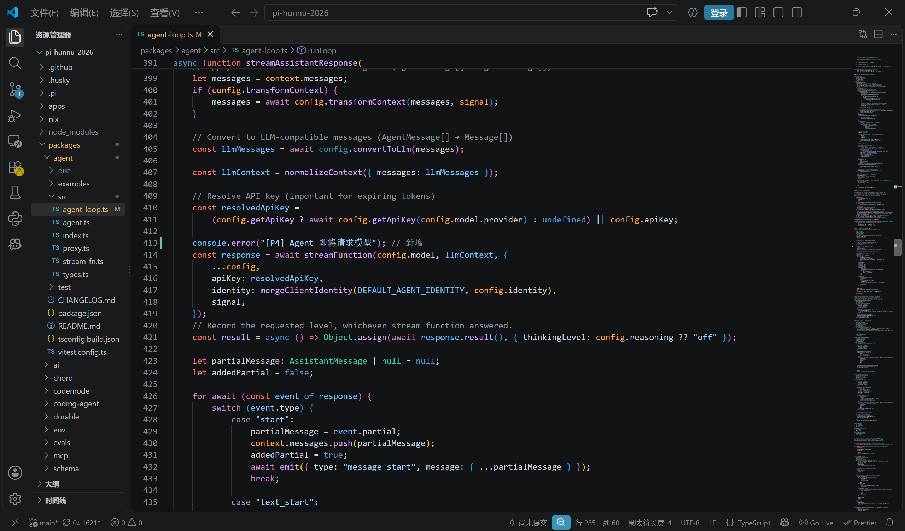

截图里能同时看到编辑器标签页文件名 `agent-loop.ts`、面包屑路径 `packages > agent > src`、行号 413 和 414、新增的日志行，以及紧接在下面的 `await streamFunction(config.model, llmContext, {`。缩进用的是 Tab，与文件原有风格一致。

### 1.2 在工具结果加入上下文后打印日志

原第 284 行的 `currentContext.messages.push(result);` 下方插入一行，插入后位于第 285 行，仍在 `for` 循环体内，缩进比 `push` 多一级：

```ts
				for (const result of toolResults) {
					currentContext.messages.push(result);
					console.error("[P4] 工具结果已加入上下文"); // 新增
					newMessages.push(result);
				}
```

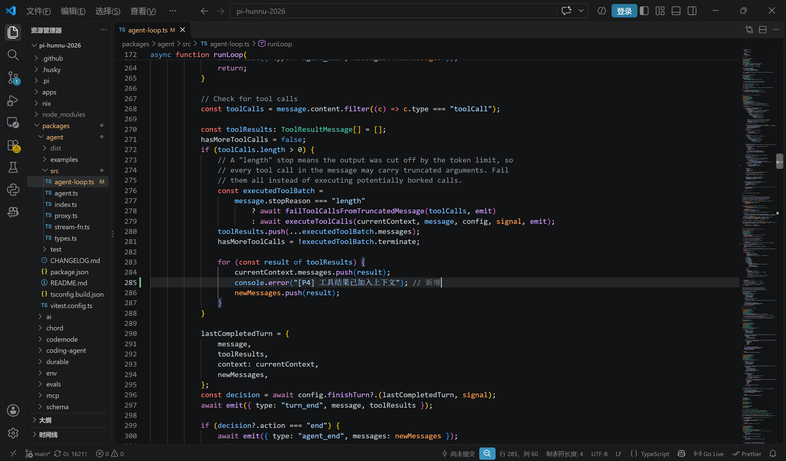

截图完整显示了 for 循环、`currentContext.messages.push(result)`、紧接着的日志行和后面的 `newMessages.push(result)`。因为写在循环里，所以每写入一条工具结果就打印一次，不是每轮打印一次。

### 1.3 代码差异

```diff
@@ -282,6 +282,7 @@
 			for (const result of toolResults) {
 				currentContext.messages.push(result);
+				console.error("[P4] 工具结果已加入上下文"); // 新增
 				newMessages.push(result);
 			}
@@ -409,6 +410,7 @@
 	const resolvedApiKey =
 		(config.getApiKey ? await config.getApiKey(config.model.provider) : undefined) || config.apiKey;
 
+	console.error("[P4] Agent 即将请求模型"); // 新增
 	const response = await streamFunction(config.model, llmContext, {
```

`git diff --stat` 的结果是 `1 file changed, 2 insertions(+)`，只增加两行，没有删除、没有重排、没有改任何逻辑。

两行日志各有分工：第一行打在“循环准备把当前上下文交给模型”的位置，所以每进入一轮模型调用出现一次；第二行打在“工具结果写入上下文”之后，所以每写入一条工具结果出现一次。本课全部观察都建立在这个区别上。

---

## 2. 任务二 重新编译

在仓库根目录（含根 `package.json`）执行：

```powershell
npm run build:offline
"EXIT=$LASTEXITCODE"
```

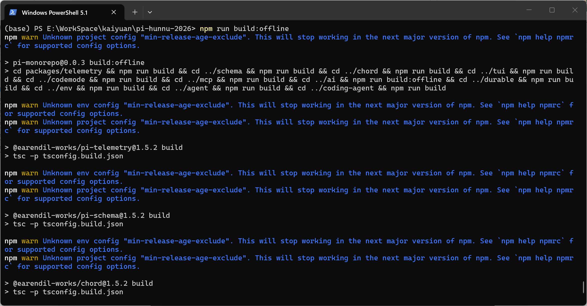

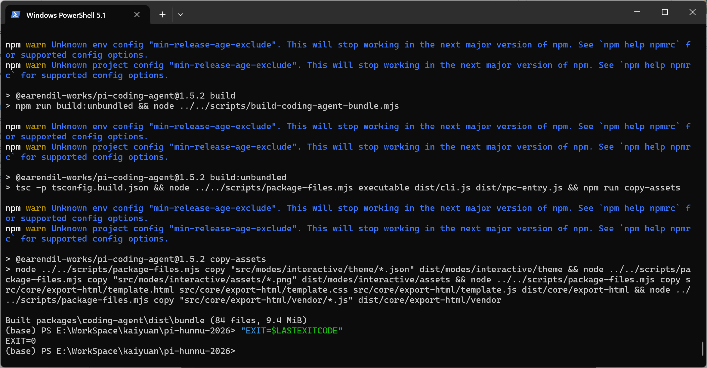

结果：十一站依次通过（telemetry → schema → chord → tui → codemode → mcp → ai → durable → env → agent → coding-agent），最后 `Built packages\coding-agent\dist\bundle (84 files, 9.4 MiB)`，`EXIT=0`，命令提示符正常返回。日志里只有 `Unknown project config "min-release-age-exclude"` 这类 `.npmrc` 配置提示，不影响构建。

除了看总体退出码，还确认改动确实进了产物：

```powershell
Select-String -Path .\packages\agent\dist\agent-loop.js -Pattern '\[P4\]'
```

命中 `dist\agent-loop.js:175` 与 `dist\agent-loop.js:277` 两处，说明 `dist` 是由此次带日志的 `src` 编译出来的，而不是旧产物。

---

## 3. 启动编译产物

构建成功返回后，直接启动产物：

```powershell
node .\packages\coding-agent\dist\cli.js
```

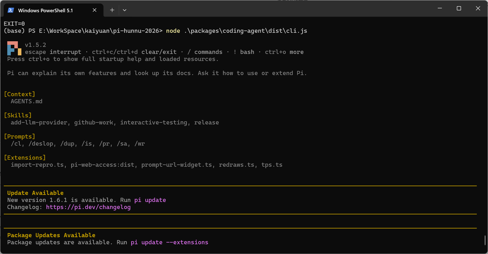

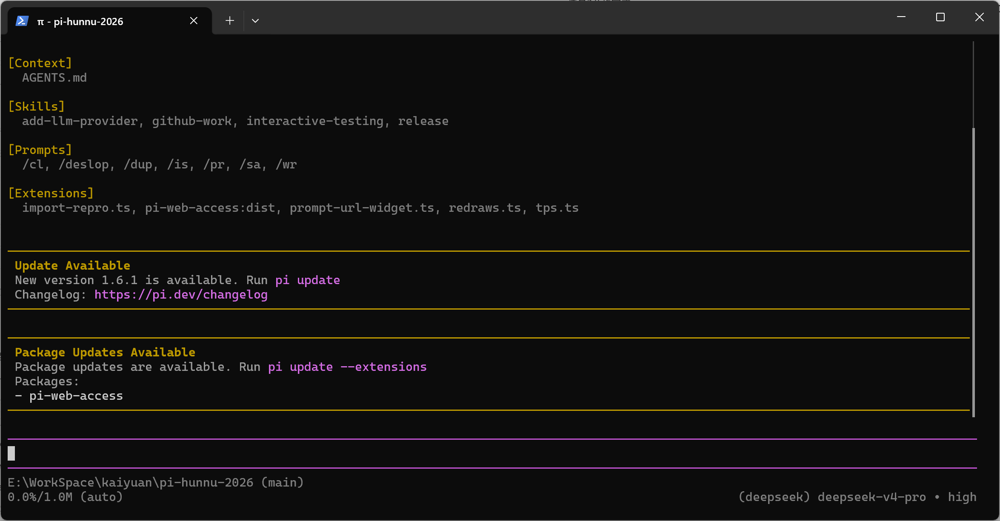

截图上半部分是上一轮构建的 `EXIT=0` 与提示符，紧接着是启动命令本身；界面显示 `v1.5.2`、`[Context] AGENTS.md`、`[Skills]`、`[Prompts]`、`[Extensions]`，底部工作目录为 `E:\WorkSpace\kaiyuan\pi-hunnu-2026 (main)`，右侧模型 `deepseek-v4-pro`。因为与之前安装的 Pi 共用 `~/.pi/agent` 配置目录，启动时没有要求重新登录。截图中没有出现 API Key、`auth.json` 或授权回调地址。

界面上的 `Update Available` / `Package Updates Available` 是官方版本提示（新版本 1.6.1），与本次实验无关，没有执行 `pi update`，避免把本地源码版替换成全局版本。

---

## 4. 会话 A：直接问答

在项目根目录新建 `practice4.txt`，写入一行自定实验代号：`P4-AGT-20261126-K7X`。然后在 Pi 里新建一个会话，输入：

```text
请直接用一句话解释什么是 Git 分支。
```

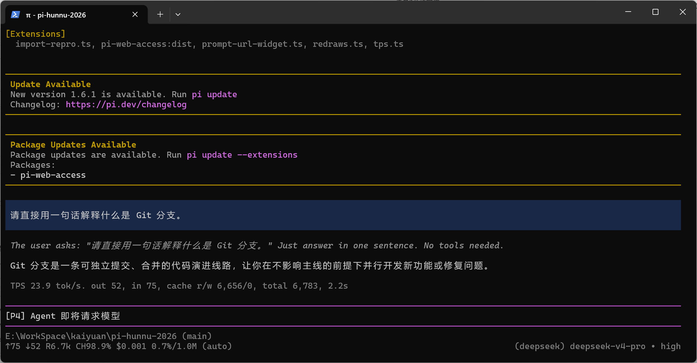

实际记录：

| 观察项 | 结果 |
|---|---|
| 输入指令 | 请直接用一句话解释什么是 Git 分支。 |
| 是否调用工具 | 否。推理行写明 `No tools needed`，界面中没有出现任何工具块 |
| `[P4]` 日志 | 只有 1 条：`[P4] Agent 即将请求模型` |
| 模型调用轮数 | 1 轮 |
| 最终回复 | “Git 分支是一条可独立提交、合并的代码演进线路，让你在不影响主线的前提下并行开发新功能或修复问题。” |
| 本轮用量 | out 52 tok，in 75 tok，cache r/w 6,656 |

只有一条日志是有原因的：上下文里没有需要执行的工具，Agent 拿到模型回复后直接结束，循环只走了一轮，所以“即将请求模型”出现一次，“工具结果已加入上下文”一次都没有出现。这条日志本身就说明模型调用发生了，而工具没有发生。

会话结束后界面给出恢复入口 `pi --session 01a2171d-2739-70ba-b67e-b11cf861e8fa`：

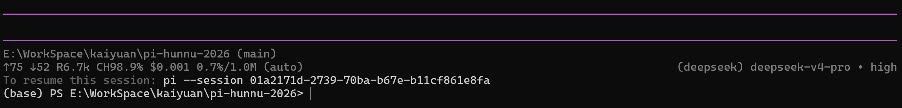

---

## 5. 会话 B：读取文件

再开一个新会话，只给文件名，代号留在文件里：

```text
请用 `read` 工具读取当前目录的 `practice4.txt`，并告诉我文件中的实验代号。
```

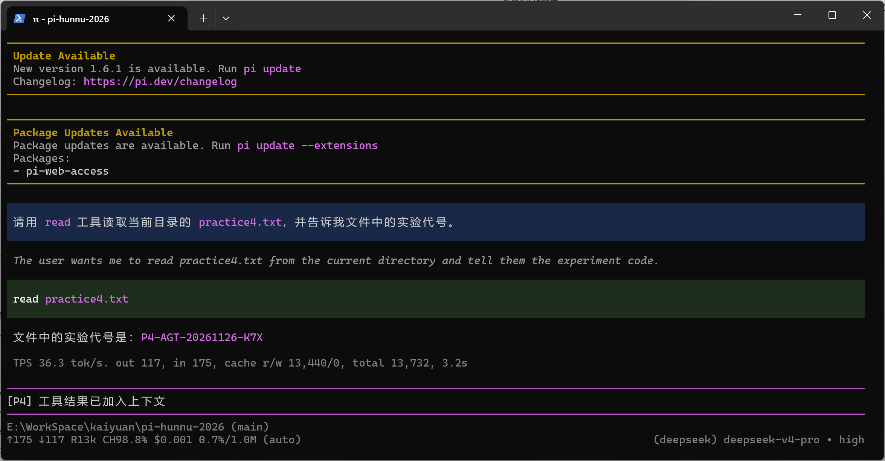

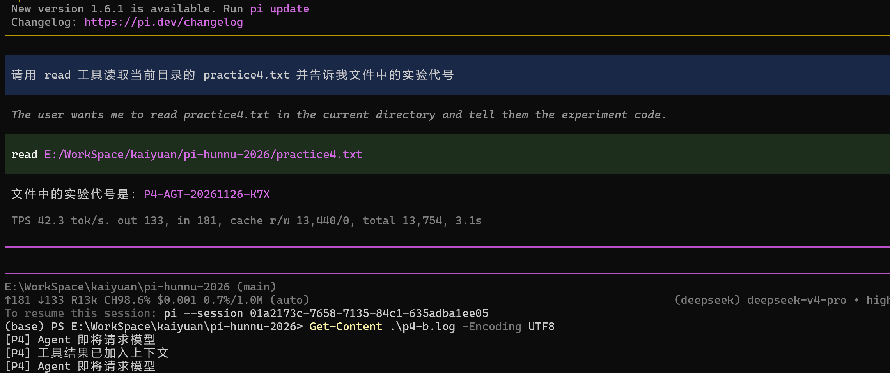

界面里依次可以看到：提问 → 推理行 `The user wants me to read practice4.txt...` → 绿色工具块 `read practice4.txt` → 回复“文件中的实验代号是：P4-AGT-20261126-K7X”。界面底部同一屏只保留了一条 `[P4] 工具结果已加入上下文`，前两条被 TUI 刷新掉了。因此把 stderr 重定向到文件，退出后再按顺序抄录；重定向这一步用 cmd 转发、读取时指定 UTF-8，都是为了绕开第 8 节困难 2 里那个编码问题：

```powershell
cmd /c "node .\packages\coding-agent\dist\cli.js 2> .\p4-b.log"
Get-Content .\p4-b.log -Encoding UTF8
```

S6-a 是同一条指令在运行中的界面截图，S6-b 是为拿到完整日志而重跑的一次，两屏指令与行为完全一致，下文的数据以后一次为准。

```text
[P4] Agent 即将请求模型
[P4] 工具结果已加入上下文
[P4] Agent 即将请求模型
```

实际记录：

| 观察项 | 结果 |
|---|---|
| 输入指令 | 请用 `read` 工具读取当前目录的 `practice4.txt`，并告诉我文件中的实验代号。 |
| 是否调用工具 | 是，调用 `read` 一次，参数为 `E:/WorkSpace/kaiyuan/pi-hunnu-2026/practice4.txt` |
| `[P4]` 日志顺序 | 即将请求模型 → 工具结果已加入上下文 → 即将请求模型（共 3 条） |
| 模型调用轮数 | 2 轮 |
| 最终回复 | “文件中的实验代号是：P4-AGT-20261126-K7X” |
| 本轮用量 | out 133 tok，in 181 tok，cache r/w 13,440 |
| 恢复入口 | `pi --session 01a2173c-7658-7135-84c1-635adba1ee05` |

代号一个字都没错，说明读到的是真实文件内容，不是模型猜的。日志的三条正好对应循环的两轮：第一轮请求模型 → 模型返回一个 toolCall → 工具执行、结果写入上下文 → 第二轮把带工具结果的上下文再请求一次 → 模型给出最终回答。

---

## 6. 两次会话对比

| 对比项 | A 直接问答 | B 读取文件 |
|---|---|---|
| 输入指令 | 请直接用一句话解释什么是 Git 分支。 | 请用 `read` 工具读取当前目录的 `practice4.txt`，并告诉我文件中的实验代号。 |
| 是否调用工具 | 否 | 是，`read` 一次（读的都是根目录这个文件） |
| 按顺序的 `[P4]` 日志 | `Agent 即将请求模型`（1 条） | `Agent 即将请求模型` → `工具结果已加入上下文` → `Agent 即将请求模型`（3 条） |
| 模型调用轮数 | 1 轮 | 2 轮 |
| 最终回复 | Git 分支是……并行开发新功能或修复问题。 | 文件中的实验代号是：P4-AGT-20261126-K7X |
| 末轮输入 token | 75 | 181 |

A 与 B 的差别不在模型，而在上下文里有没有工具结果。A 的上下文只有一条用户消息，Agent 循环走一轮就结束；B 的上下文在中间多出一条工具结果，模型因此需要再看一遍完整上下文才能作答，循环走了两轮。

**谁实际读了文件？**

不是模型读的。`read` 是 coding-agent 进程里的本地工具，由本机的 Node 进程打开 `practice4.txt`、读取正文，再把结果作为工具结果消息回填给 agent 循环。模型只收到这段文本，它对本地文件系统没有直接访问能力，也拿不到路径以外的信息。B 回复的代号与文件内容完全一致，正是这条链路走通的证据。

**下一轮模型请求多带了什么？**

多带了两条消息：一条是模型自己上一轮产出的 assistant `toolCall`（要求调用 `read`、参数 `practice4.txt`），另一条是紧随其后的工具结果消息，内容包括工具名、参数和文件正文 `P4-AGT-20261126-K7X`。第二轮请求的上下文就是“用户问题 + 我要读文件 + 读到的内容”，所以末轮输入从 A 的 75 token 涨到 B 的 181 token。日志的第二、三条挨着出现，正是这个动作留下的痕迹：先记录结果入列，紧接着记录新一轮请求。

---

## 7. 运行架构简图

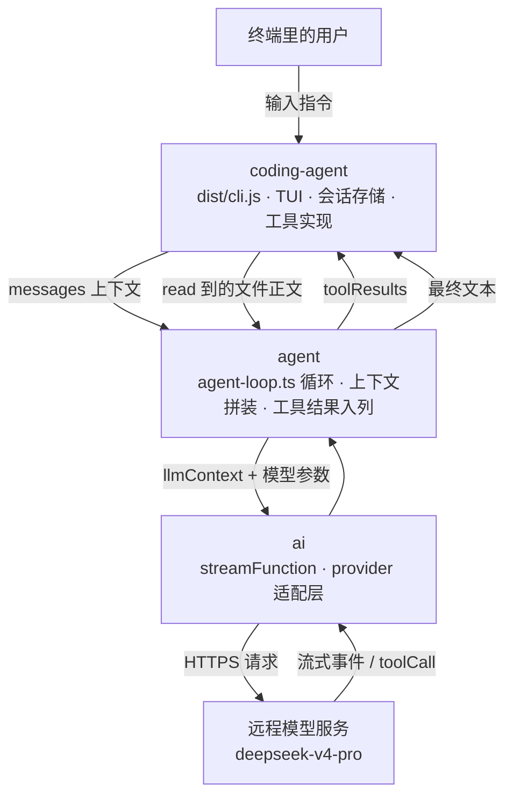

各层在这次实验里的具体角色：

- **coding-agent**：进程入口与外壳。它读命令行参数、开 TUI、保存会话，并持有 `read`、`bash`、`edit`、`write` 这些工具的本地实现。`dist/cli.js` 就是这一层的打包产物。
- **agent**：`agent-loop.ts` 所在的循环。它维护 `messages` 上下文，每轮把上下文交给 `streamFunction`，拿到回复后判断有没有 `toolCall`，有就执行工具、把结果写回上下文，再进入下一轮。两行 `[P4]` 日志都打在这一层。
- **ai**：模型接入层。`streamFunction` 按 provider 选择协议、拼请求、解析流式事件，把统一的 assistant 消息和 `toolCall` 交回 agent。它不碰文件，只负责与远程服务通信。
- **远程模型服务**：真正生成文字的一方，通过 HTTPS 接收请求、流式返回内容与工具调用意图。

一次 B 会话在图上走的路：用户输入 → coding-agent 组装上下文 → agent 第一轮请求 → ai 发 HTTPS → 远程服务返回 `read` 的 toolCall → agent 把 toolCall 交回 coding-agent 执行 → 工具结果回到 agent 写入上下文（`[P4] 工具结果已加入上下文`）→ agent 第二轮请求（`[P4] Agent 即将请求模型`）→ 远程服务返回最终文本 → TUI 显示。A 会话省掉了中间所有工具相关的箭头，只剩第一轮请求和最终文本。

---

## 8. 遇到的困难

### 困难 1：保存时编辑器把整个文件重排，行号全乱

现象。第一次插入两行后保存，VS Code 的 Prettier 把文件原有的 Tab 缩进整体改成 2 个空格，`git diff` 从“2 行新增”变成数百行改动，行号也从 284 / 412 漂到 469 / 316 附近。《实践课4》文档要求截图里行号与语句对得上，这样拍出来的截图没法用。

定位。不是插入位置错了，是格式化钩子在保存时重写了全文缩进。文件本身用 Tab，Prettier 配置按 2 空格，两者冲突。

解决。先 `git restore` 撤销被重排的文件，再关掉该工作区的 format on save，然后用 `File: Revert File` 让编辑器缓冲区重新读磁盘内容，最后在 PowerShell 里按原 Tab 缩进精确插入这两行。复核结果 `1 file changed, 2 insertions(+)`，行号回到 285 与 413，截图 S1、S2 的行号与文档要求一致。

### 困难 2：`[P4]` 日志会被 TUI 覆盖，重定向又被 PowerShell 转码

现象。会话 A 结束后界面只剩一条日志，会话 B 里前两条日志在滚动后消失，退出后终端恢复成启动前的画面，日志一条也不留。老师要求“按出现顺序”记录，靠肉眼记不可靠。于是加 `2> .\p4-b.log` 想把 stderr 存成文件，结果日志文件能生成，但打开是乱码，还夹着一堆多余的行：

```text
node : [P4] Agent 鐭冲瓨鏈嶅姟… 所在位置 行:1 字符: 1
+ CategoryInfo          : NotSpecified: ([P4] Agent …
+ FullyQualifiedErrorId : NativeCommandError
```

定位。两件事叠在一起。一是 Pi 用备用屏幕缓冲，退出时恢复原屏，`[P4]` 日志和 TUI 混在同一块屏幕里，滚动区有限，肉眼留不住。二是当前窗口是 Windows PowerShell 5.1，它把外部程序的 stderr 当作错误记录处理，按控制台代码页（GBK）解码一遍再写进文件，于是 UTF-8 的中文变成乱码，PowerShell 还给它套上 `NativeCommandError` 的壳。

解决。让 cmd 负责转发，避开 PowerShell 的解码环节；读回来时显式指定 UTF-8：

```powershell
cmd /c "node .\packages\coding-agent\dist\cli.js 2> .\p4-b.log"
Get-Content .\p4-b.log -Encoding UTF8
```

结果。日志文件是干净的三行纯文本，不受 TUI 刷新影响，S6-b 就是这份文件的内容。会话 A 只需一条日志，界面里直接可见，不需要重定向。

### 困难 3：`npm run build` 在本机仍会卡在模型目录生成

现象。按文档执行 `npm run build`，进入 `ai` 子包的 `generate-models` 后又中止，错误是 `radius.pi.dev` 连接超时（`ConnectTimeoutError`，目标 IP 104.21.62.67:443），换一次又报 `models.dev` 的 `UND_ERR_BODY_TIMEOUT`。

定位。`generate-models` 即 `node catalog/generate.ts --strict`，严格模式下任一数据源不可达就整体中止，属于网络可达性问题，不是编译错误。模型目录数据此前已生成到 `packages/ai/src/providers/data/`（被 `.gitignore` 忽略），本机不需要再联网重生成。

解决。改用文档中等价的离线构建 `npm run build:offline`，只编译、复用现有目录数据。这与实践课3 的处理一致：数据已就绪的机器上，日常重编译一律走 `build:offline`。构建本身（含 `agent` 子包和 `coding-agent` 打包）与 `build` 完全相同，S3-a、S3-b 的十一站输出可以对照。

---

## 9. 自检

| 老师要求 | 本次证据 | 结论 |
|---|---|---|
| 两处日志的代码差异或截图，标清插入位置 | `images/S1.png`（第 413～414 行）、`images/S2.png`（第 283～287 行）、第 1.3 节 diff | 原 412 / 284 行，插入后 413 / 285 行，`2 insertions` |
| 重新编译的记录 | `images/S3-a.png`、`images/S3-b.png` | 十一站通过、84 files 9.4 MiB、`EXIT=0` |
| 启动的记录 | `images/S4-a.png`、`images/S4-b.png` | 命令 + v1.5.2 界面，路径与模型可见 |
| A 的实际记录 | `images/S5-a.png`、`images/S5-b.png` | 无工具、1 条日志、1 轮模型调用、回复原文 |
| B 的实际记录 | `images/S6-a.png`、`images/S6-b.png` | `read` 一次、3 条日志按序、2 轮模型调用、代号正确 |
| 架构简图 | 第 7 节 | coding-agent / agent / ai / 远程模型服务四层与数据流 |
| 隐去授权信息 | 全部截图 | 无 API Key、无 `auth.json`、无回调地址 |

---

## 10. 提交

Issue 名称：`实践课4：Pi Agent模型调用与运行流程 【姓名拼音】`

报告地址：https://github.com/Aglioble/pi-homework/blob/main/practice4/practice-04.md

小组代码仓库：https://github.com/liushuchang1/pi-hunnu-2026

说明：本地源码已同步到老师仓库 `main`（`c3cc9163`，版本 1.5.2），本次两行日志只存在于本地工作区，未向小组远端推送，原因与实践课3 第 2 节所述一致。
