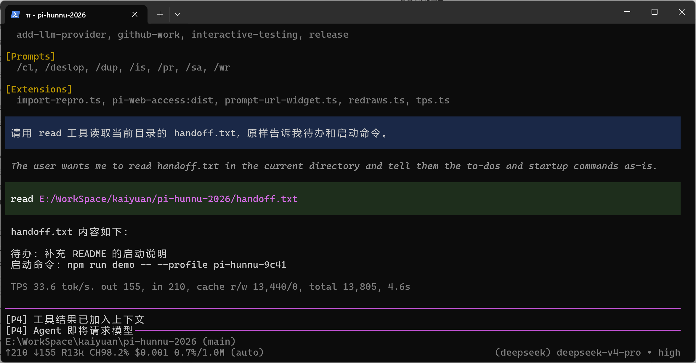
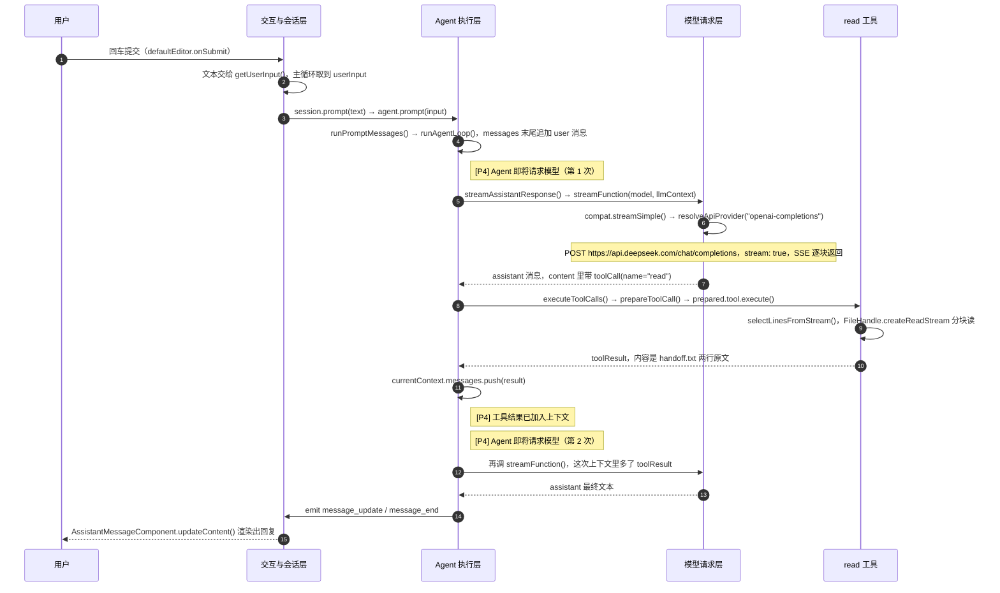
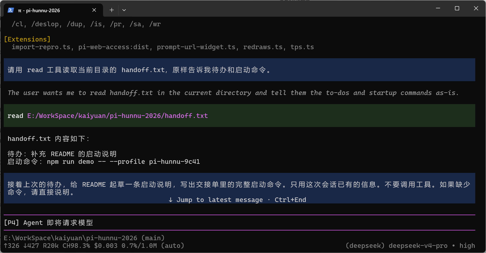
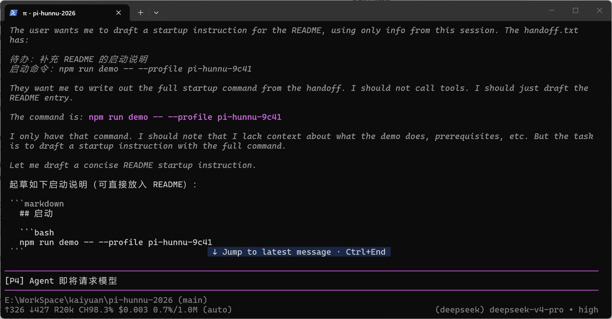
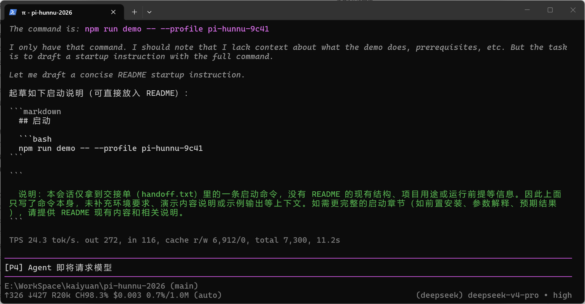
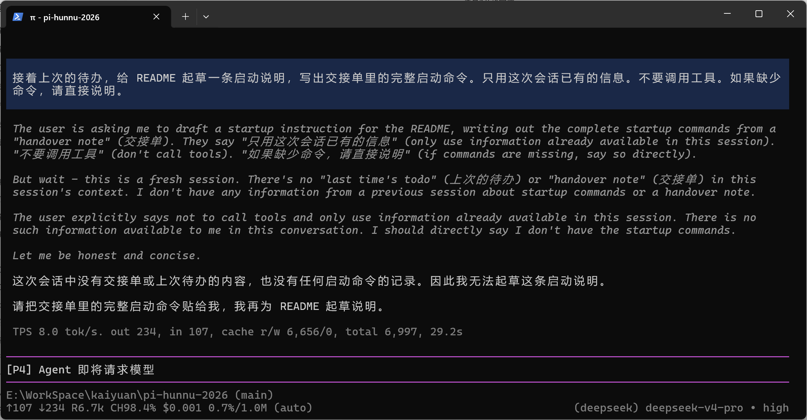
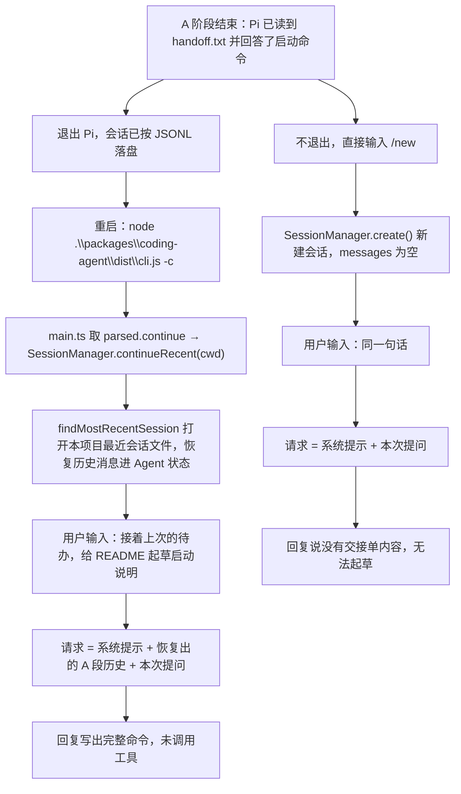

# 实践课5：Pi Agent 源码泛读与功能定位

## 0. 基本信息

| 项目 | 内容 |
|---|---|
| 姓名 / 学号 | 【填写姓名与学号】 |
| 个人报告仓库 | https://github.com/Aglioble/pi-homework（本报告位于 `practice5/` 目录） |
| 小组组织仓库 | https://github.com/liushuchang1/pi-hunnu-2026 |
| 本地源码目录 | `E:\WorkSpace\kaiyuan\pi-hunnu-2026` |
| 分支 / 提交 | `main` / `c3cc91632d0a1950fb122605b190233f2aa0006e`（版本 1.5.2） |
| 启动命令 | `node .\packages\coding-agent\dist\cli.js`（本地编译产物，与实践课4 同一个入口） |
| 会话模型 | `deepseek-v4-pro`（thinking high，provider 为 `deepseek`，API 类型 `openai-completions`） |
| 实验文件 | 仓库根目录 `handoff.txt`，两行，代号 `pi-hunnu-9c41` |

本课不新建项目，直接用实践课4 编译出的产物继续跑。A 段观察一次工具调用在代码里怎么走，B 段观察会话恢复后模型拿到的上下文有什么不同。

`handoff.txt` 内容（把老师样例里的 `river-731` 换成本组的随机标识）：

```text
待办：补充 README 的启动说明
启动命令：npm run demo -- --profile pi-hunnu-9c41
```

---

## 1. A 段：单轮交互与工具调用

在仓库根目录启动新会话：

```powershell
cd E:\WorkSpace\kaiyuan\pi-hunnu-2026
node .\packages\coding-agent\dist\cli.js
```

原样输入（提问里不带命令，命令只能从文件里拿到）：

```text
请用 read 工具读取当前目录的 handoff.txt，原样告诉我待办和启动命令。
```



实际观察：

| 观察项 | 结果 |
|---|---|
| 用户输入 | 一轮交互，一条提问 |
| 工具事件 | `read` 执行 1 次，参数是仓库根目录的 `handoff.txt` |
| 模型调用 | 2 次。第一次返回 `toolCall`，第二次带着工具结果给出回答 |
| `[P4]` 日志 | 先是 `Agent 即将请求模型`（第一条），工具执行后出现 `工具结果已加入上下文`，紧接着又一次 `Agent 即将请求模型` |
| 最终回复 | “待办：补充 README 的启动说明／启动命令：npm run demo -- --profile pi-hunnu-9c41” |
| 用量 | out 155 tok，in 210 tok，cache r/w 13,440 |

它复述的命令与 `handoff.txt` 里的完全一致，说明命令是从文件读到的，不是模型凭上下文猜的。一次用户输入对应一次交互，但这一次交互里发生了两次模型调用，两行日志的出现次数正好对应。

---

## 2. 图1：单轮工具调用的代码级时序图

以实际读取 `handoff.txt` 的这一轮为准，五条生命线按职责划分，箭头上的函数名都来自本仓库源码。



每条箭头对应的源码位置：

| 环节 | 源码位置 | 说明 |
|---|---|---|
| 输入入口 | `packages/coding-agent/src/modes/interactive/interactive-mode.ts` 的 `handleStartupSubmit` 内，`defaultEditor.onSubmit`（第 3325 行起） | 编辑器回车后先处理斜杠命令、`!` bash 命令，普通文本则交给 `onInputCallback` / `pendingUserInputs` |
| 会话层取输入 | 同文件 `getUserInput()`（第 4430 行）与主循环（第 1293～1296 行） | `while (true) { const userInput = await this.getUserInput(); await this.session.prompt(userInput); }` |
| 会话层入口 | `packages/coding-agent/src/core/agent-session.ts` 的 `AgentSession.prompt()`（第 2175 行） | 处理斜杠命令、预检（模型、鉴权），随后 `_startRun` |
| Agent 层入口 | `packages/agent/src/agent.ts` 的 `Agent.prompt()`（第 382 行） | `normalizePromptInput` 把字符串转成 user 消息，交给 `runPromptMessages()`（第 441 行） |
| 启动循环 | 同文件 `runPromptMessages` 内调 `runAgentLoop(...)` | 传入 `this.createContextSnapshot()`、`this.streamFunction`、`processEvents` |
| 循环体 | `packages/agent/src/agent-loop.ts`，`for` 循环内第 251 行的 `streamAssistantResponse()` | 每转一圈 = 一次模型调用 |
| 模型请求 | 同文件 `streamAssistantResponse()`（第 391 行）与第 414 行的 `streamFunction(config.model, llmContext, {...})` | 我们的 `[P4]` 日志就打在它上方 |
| 适配器 | `packages/ai/src/compat.ts` 的 `streamSimple()`（第 278 行）→ `resolveApiProvider(model.api)` | `deepseek-v4-pro` 的 `api` 是 `openai-completions` |
| 真正发请求 | `packages/ai/src/api/openai-completions.ts` 第 384～385 行 `client.chat.completions.create(params, ...)` | OpenAI SDK，`stream: true`，打到 `https://api.deepseek.com/chat/completions`，SSE 返回 |
| 工具执行 | `packages/agent/src/agent-loop.ts` 的 `executeToolCalls()`（第 520 行）→ `prepareToolCall()`（第 710 行）→ `prepared.tool.execute()`（第 837 行） | 单个调用且非 sequential 时走并行批次，本次只有一个调用 |
| read 实现 | `packages/coding-agent/src/core/tools/read.ts` 的 `createReadToolDefinition().execute`（第 245 行） | 先 `resolveReadPathAsync` 解析路径，再判断 MIME |
| 读取方式 | 同文件第 300～308 行 | 文本文件走 `selectLinesFromStream(ops.createReadStream(...))`；流来自 `readLocalFileChunks()`（第 81 行）的 `fsOpen` + `handle.createReadStream` |
| 结果入列 | `agent-loop.ts` 第 284 行 `currentContext.messages.push(result)` | 我们的第二条 `[P4]` 日志紧跟其后 |
| 显示回复 | `interactive-mode.ts` 的 `handleEvent`，`message_update` 分支（第 3649 行）更新流式组件，`message_end` 分支（第 3685 行）定稿 | 由 `subscribeToAgent()`（第 3525 行）注册的会话订阅触发 |

关于读取方式，源码核对结论是流式分段读，不是整块读进缓冲区。`read.ts` 第 300 行的三元判断为：`ops.createReadStream && isStreamableRange(offset, limit)` 成立就走 `selectLinesFromStream`，否则退回 `selectLinesFromBuffer(await ops.readFile(...))`。本次调用没有 offset 也没有 limit，`isStreamableRange(undefined, undefined)` 为真，默认 `ops.createReadStream` 就是 `readLocalFileChunks`，所以走的是流式路径。缓冲区路径用于两种情况：图片文件（第 277 行），以及 offset / limit 传了非法值这类不可流式的区间。

还有一处同层内的跨文件调用值得标出来：`agent-session.ts` 并不自己请求模型，它把 `agent.streamFunction` 一路传进 `runAgentLoop`（见 `agent.ts` 的 `runPromptMessages`），最后由 `agent-loop.ts` 在每轮开头调用。也就是说“请求模型”这个动作在代码里由 Agent 层发起，真正的 HTTP 通信在 ai 层完成，两层之间在时序图上正好是相邻的两条生命线。

---

## 3. B 段：恢复旧会话与新建会话

先退出 Pi，确认 `handoff.txt` 那轮已经存进会话文件，然后加 `-c` 重新打开：

```powershell
node .\packages\coding-agent\dist\cli.js -c
```

打开后上方能看到 A 段的完整聊天记录（提问、`read handoff.txt` 工具块、两条文件内容），说明历史是从会话文件恢复的，不是重新读的。接着输入：

```text
接着上次的待办，给 README 起草一条启动说明，写出交接单里的完整启动命令。只用这次会话已有的信息。不要调用工具。如果缺少命令，请直接说明。
```







它没有调用任何工具，直接写出了完整命令：

> 起草如下启动说明（可直接放入 README）：`npm run demo -- --profile pi-hunnu-9c41`

并在后面补充“本次会话只拿到交接单里的一条启动命令，没有 README 现有结构、项目用途等信息”。用量：out 272 tok，in 116 tok，cache r/w 6,912。

然后不退出，在界面里输入 `/new` 开一个全新会话，把完全相同的那句再发一遍：



这次它明确说：

> 这次会话中没有交接单或上次待办的内容，也没有任何启动命令的记录。因此我无法起草这条启动说明。请把交接单里的完整启动命令贴给我，我再为 README 起草说明。

用量：out 234 tok，in 107 tok，cache r/w 6,656。两次都没有工具块，两屏日志都只有一条 `[P4] Agent 即将请求模型`。

对照结果：

| 对比项 | 恢复旧会话（`-c`） | 新建会话（`/new`） |
|---|---|---|
| 历史消息 | A 段的提问、工具块、文件内容都在界面上 | 空的，只有本次提问 |
| 是否调用工具 | 否 | 否 |
| 是否答出完整命令 | 是，`npm run demo -- --profile pi-hunnu-9c41` | 否，明确说没有记录，要求补充 |
| `[P4]` 日志 | 1 条 `Agent 即将请求模型` | 1 条 `Agent 即将请求模型` |
| 用量 | out 272，in 116，cache r/w 6,912 | out 234，in 107，cache r/w 6,656 |

缓存数差得最直白：恢复那次多命中约 250 个 token 的缓存，差值正好对应 A 段那一轮的用户消息、工具调用和工具结果；新会话命中的只有系统提示那部分。这一条比“界面上看着像”更硬，能佐证恢复的历史确实进了请求。

---

## 4. 图2：恢复旧会话与新建会话的上下文对照



两条分支的关键差别只有一处：左边把会话文件里的历史消息重新装进 Agent 的 `messages`，右边是从空数组开始。用户输入完全相同、模型完全相同、提示词同样要求不要调用工具，唯一变量就是上下文里有没有 A 段读到的内容，所以答案一个能写出命令，一个写不出。

对应源码：`-c` 的解析在 `packages/coding-agent/src/cli/args.ts`（第 111 行 `--continue | -c`），`main.ts` 的 `createSessionManager`（第 480 行 `SessionManager.continueRecent(cwd, sessionDir)`）取最近会话，`session-manager.ts` 的 `continueRecent`（第 1811 行）通过 `findMostRecentSession` 找到 JSONL 文件并载入条目；`/new` 走的是新建路径（`SessionManager.create`，第 1773 行），没有历史可载。会话文件的位置由 `session-manager.ts` 第 588～594 行决定，是本项目工作目录编码后落在 `~/.pi/agent/sessions/` 下的子目录。